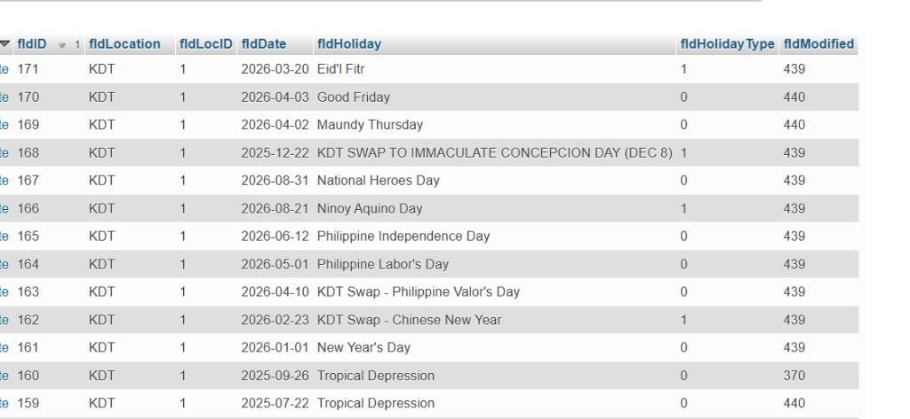

# Holidays API — Backend draft

## Goal

Expose company holidays from the existing **`kdtholiday`** table so the frontend date picker can disable non-working days (e.g. Ninoy Aquino Day on `2026-08-21`), and so leave duration / validation stays consistent with the backend.

The frontend already:

- Treats **weekends** as non-working locally (`Sat` / `Sun`)
- Needs **holidays** from the API as ISO dates (`YYYY-MM-DD`)
- Uses a custom date picker (`DateFieldCustom`) that disables days when `weekdaysOnly` is on

Filing pages load these dates from the API. Weekends are still excluded in the browser.

---

## Source table: `tblHolidays`

Screenshot of live data (phpMyAdmin / Heidi-style view of `kdtphdb › kdtholiday`):



### Columns (as in DB)

| Column | Example | Notes |
|--------|---------|--------|
| `fldID` | `166` | Primary key |
| `fldLocation` | `KDT` | Location label |
| `fldLocID` | `1` | Location id — filter by employee location when needed |
| `fldDate` | `2026-08-21` | Calendar date (`YYYY-MM-DD`) — **do not apply timezone shifts** |
| `fldHoliday` | `Ninoy Aquino Day` | Holiday name / label (also includes ad-hoc closures, e.g. Tropical Depression, swap days) |
| `fldHolidayType` | `0` or `1` | Holiday classification (see below) |
| `fldModified` | `439` | Modifier metadata — **do not expose** on the public list API |

### `fldHolidayType` (confirm with domain / existing leave code)

From sample rows, both `0` and `1` appear on days that should not be worked:

| Value | Likely meaning (PH calendar convention) | Sample |
|-------|------------------------------------------|--------|
| `0` | Regular holiday | New Year's Day, Good Friday, Labor Day, Christmas Day |
| `1` | Special non-working / special holiday | Ninoy Aquino Day, National Heroes Day, Eid'l Fitr, EDSA |

**For leave filing / working-day counting / date-picker blocking:** treat **every row in `kdtholiday` for the relevant location as a non-working day**, unless existing backend leave logic already filters by `fldHolidayType`. If leave duration already ignores one type, match that behavior exactly — do not invent a new rule.

> **Action for implementer:** grep the leaveforms-api / legacy leave code for `kdtholiday` / `fldHolidayType` and align this endpoint with that logic.

### Sample rows (from screenshot)

| fldID | fldLocID | fldDate | fldHoliday | fldHolidayType |
|------:|---------:|---------|--------------|---------------:|
| 171 | 1 | 2026-03-20 | Eid'l Fitr | 1 |
| 170 | 1 | 2026-04-03 | Good Friday | 0 |
| 169 | 1 | 2026-04-02 | Maundy Thursday | 0 |
| 166 | 1 | **2026-08-21** | **Ninoy Aquino Day** | 1 |
| 165 | 1 | 2026-08-31 | National Heroes Day | 1 |
| 161 | 1 | 2026-01-01 | New Year's Day | 0 |
| 160 | 1 | 2025-09-26 | Tropical Depression | 0 |
| 168 | 1 | 2025-12-22 | KDT SWAP TO IMMACULATE CONCEPCION DAY (DEC 8) | 1 |

---

## Endpoint

### List holidays in a date range

```http
GET /api/holidays?from=2026-08-01&to=2026-08-31
```

**Auth:** Same as other Leave Forms API routes (portal `userID` cookie / existing middleware). Any authenticated employee can read.

**Query params**

| Param | Type | Required | Description |
|-------|------|----------|-------------|
| `from` | `YYYY-MM-DD` | Yes* | Inclusive start of range (`fldDate >= from`) |
| `to` | `YYYY-MM-DD` | Yes* | Inclusive end of range (`fldDate <= to`) |
| `year` | `integer` | No | Shortcut: all holidays for that calendar year. If both `from`/`to` and `year` are sent, prefer `from`/`to` |
| `loc_id` | `integer` | No | Filter `fldLocID`. Default: current employee's location (or `1` / KDT if that is the org default). Do **not** return all locations mixed unless explicitly requested |

\* Either (`from` + `to`) **or** `year` is required.

**Validation rules**

- `from` / `to` must be valid dates
- `to` must be `>= from`
- Max range: e.g. **400 days** (prevents accidental full-history dumps)
- `year` must be a reasonable 4-digit year (e.g. 2000–2100)

**Success response** — Laravel JsonResource collection (no pagination; ranges are small):

```json
{
  "data": [
    {
      "id": 166,
      "date": "2026-08-21",
      "name": "Ninoy Aquino Day",
      "holiday_type": 1,
      "is_non_working": true,
      "location_id": 1,
      "location": "KDT"
    },
    {
      "id": 165,
      "date": "2026-08-31",
      "name": "National Heroes Day",
      "holiday_type": 1,
      "is_non_working": true,
      "location_id": 1,
      "location": "KDT"
    }
  ]
}
```

**Resource field mapping**

| API field | DB column | Notes |
|-----------|-----------|--------|
| `id` | `fldID` | |
| `date` | `fldDate` | Always `Y-m-d` string — no timezone conversion |
| `name` | `fldHoliday` | |
| `holiday_type` | `fldHolidayType` | `0` or `1` — expose raw value |
| `is_non_working` | derived | `true` when this row should block leave / be disabled in the picker (default: `true` for all rows returned; if backend leave math only counts certain types, derive accordingly) |
| `location_id` | `fldLocID` | |
| `location` | `fldLocation` | |

Omit `fldModified` from the JSON.

Do **not** include pagination `meta` / `links` unless necessary. The frontend expects a simple `{ data: T[] }` list via `apiGetList`.

**Error responses**

| Status | When |
|--------|------|
| `401` | Unauthenticated (existing `login_url` payload) |
| `422` | Invalid / missing `from`/`to`/`year`, or range too large |

Example `422`:

```json
{
  "message": "The given data was invalid.",
  "errors": {
    "from": ["The from field is required when year is not present."],
    "to": ["The to field must be a date after or equal to from."]
  }
}
```

---

## Suggested Laravel pieces

### Model

```php
// App\Models\Holiday (or existing model name for tblHolidays)
protected $table = 'tblHolidays';
protected $primaryKey = 'fldID';

protected $casts = [
    'fldDate' => 'date:Y-m-d',
    'fldHolidayType' => 'integer',
    'fldLocID' => 'integer',
];
```

### Route

```php
// routes/api.php (inside existing auth middleware group)
Route::get('/holidays', [HolidayController::class, 'index']);
```

### Controller sketch

```php
public function index(Request $request)
{
    $validated = $request->validate([
        'from' => ['required_without:year', 'date_format:Y-m-d'],
        'to' => ['required_without:year', 'date_format:Y-m-d', 'after_or_equal:from'],
        'year' => ['required_without:from', 'integer', 'min:2000', 'max:2100'],
        'loc_id' => ['sometimes', 'integer', 'min:1'],
    ]);

    // Resolve $from / $to from year if needed:
    //   from = "{year}-01-01", to = "{year}-12-31"
    // Enforce max span (e.g. 400 days) when from/to used.

    $locId = $validated['loc_id']
        ?? /* current employee's location id */
        ?? 1;

    $rows = Holiday::query()
        ->where('fldLocID', $locId)
        ->whereDate('fldDate', '>=', $from)
        ->whereDate('fldDate', '<=', $to)
        ->orderBy('fldDate')
        ->get();

    return HolidayResource::collection($rows);
}
```

### JsonResource sketch

```php
return [
    'id' => $this->fldID,
    'date' => $this->fldDate instanceof \Carbon\Carbon
        ? $this->fldDate->format('Y-m-d')
        : (string) $this->fldDate,
    'name' => (string) $this->fldHoliday,
    'holiday_type' => (int) $this->fldHolidayType,
    // Align with existing leave working-day rules:
    'is_non_working' => true,
    'location_id' => (int) $this->fldLocID,
    'location' => (string) $this->fldLocation,
];
```

**Timezone:** Store and return calendar dates only. Avoid UTC shifts that turn `2026-08-21` into `2026-08-20`.

---

## Frontend consumption (context for backend)

1. File Leave loads holidays for a window (e.g. today → +12–18 months, or the visible picker month).
2. Builds a `Set` of `date` where `is_non_working === true`.
3. Custom date picker disables a day if weekend **or** date ∈ that set.
4. Leave **duration / paid / LWOP** must still be computed and validated on the **backend** when creating/updating leaves (frontend picker is UX only, not the source of truth).

Related product note from `docs/FRONTEND.md`:

> Date range + day type → duration from API (workdays / holidays)

So this holidays list endpoint is for **UI blocking / display**. Duration math stays inside leave store/update (or a future `POST /leaves/preview`), using the same `tblHolidays` data.

---

## Out of scope (for now)

- Admin CRUD for holidays (POST/PUT/DELETE)
- Returning weekends from this endpoint (frontend handles weekends)
- Multi-location aggregation in one response (filter by `loc_id` instead)

---

## Acceptance checklist

- [ ] `GET /api/holidays?from=&to=` reads from `tblHolidays`
- [ ] Filters by `fldLocID` (default current employee / KDT)
- [ ] Dates are `YYYY-MM-DD` strings with no timezone drift
- [ ] Response is `{ "data": [ ... ] }` JsonResource collection
- [ ] Known row `fldDate = 2026-08-21` (Ninoy Aquino Day) appears when querying August 2026 for `loc_id=1`
- [ ] Invalid range → `422`
- [ ] Unauthenticated → existing `401` + `login_url` behavior
- [ ] Leave create still rejects invalid working-day ranges even if the client bypasses the picker
- [ ] `is_non_working` / which `fldHolidayType` values count match existing leave duration logic

---

## Optional follow-ups (not required for v1)

1. `GET /api/holidays?year=2026` shortcut (via `year` param above).
2. `POST /api/leaves/preview` returning `{ duration, paid_days, lwop_days }` using the same `tblHolidays` table.
3. Short server/HTTP cache (holiday rows change infrequently).
